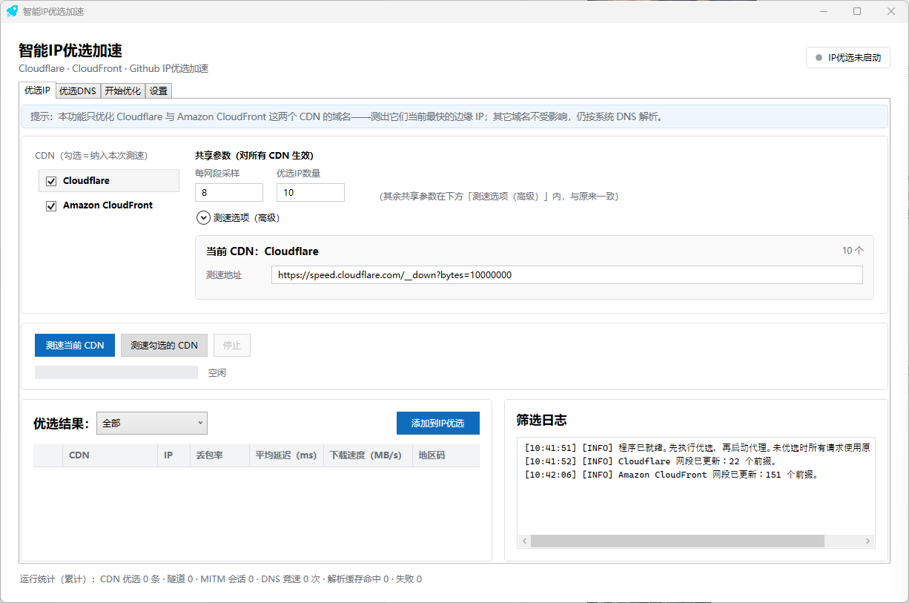
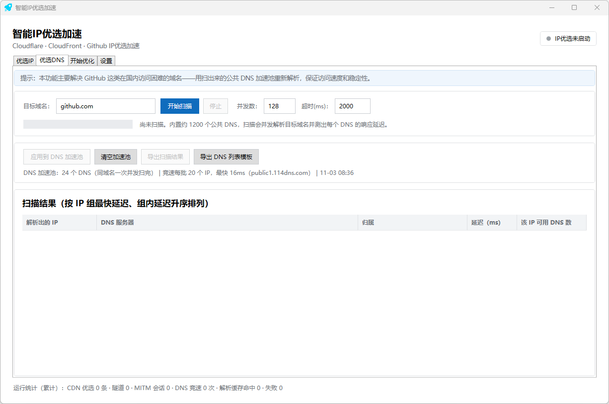
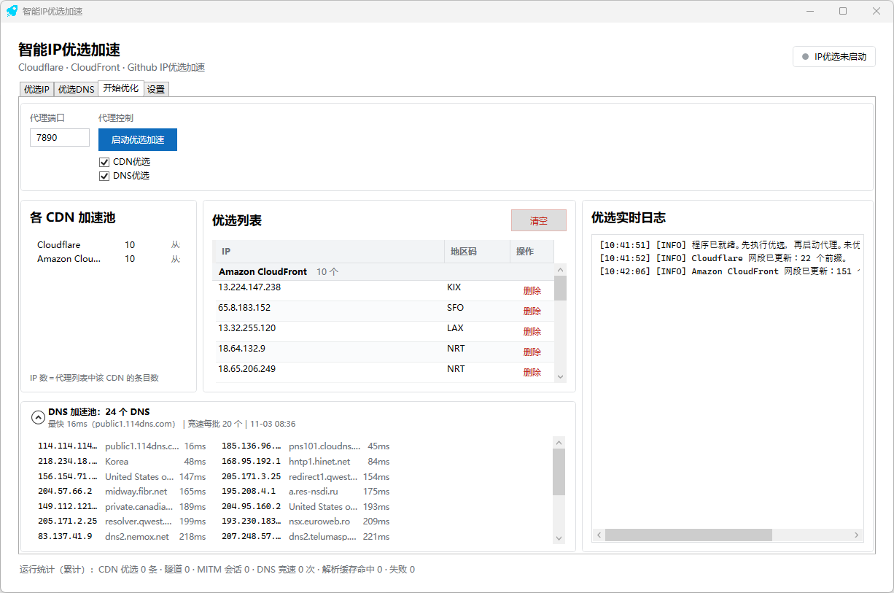

# 智能IP优选加速 —— GitHub / Cloudflare 加速

**写在前面**
- 本代码不具备“翻墙”功能,以后也不会有。
- 本代码不能为您的游戏加速

## 痛点：
- GitHub 经常打不开；
- 国外网站几乎都在用 Cloudflare，页面还加载 `cdn.jsdelivr.net`这类 CF 静态资源——我们国内只分配很少一部分慢的节点。

---

## 功能

### 1. Github优选加速 —— 治「Github打不开」

- 对你白名单里的域名GitHub做「多 DNS 并发解析 + 多 IP 并发竞速」，提升Github连通率90%。

### 2. Cloudflare、Amazon CloudFront优选加速 —— 治「国外网站访问慢」

- 给已接入的 CDN（**Cloudflare**、**Amazon CloudFront**）实测出当前这条线路上最快的边缘 IP，凡是解析结果落进这些网段的域名，都改成这些 IP。

## 系统支持

- **只支持 Windows**（WPF / .NET 8，需桌面环境，建议 Win10 / 11 x64）。**免安装**单文件 `IPOptimize.exe`，解压双击即用。

---

## 使用方法

### 步骤 1 ·「优选CDN」页 —— 测出最快的 CDN 边缘 IP

 筛选cloudflare/cloudfont的CDN优选IP。

### 步骤 2 ·「优选DNS」页 —— 建 DNS 加速池

 筛选Github这类有IP污染的真实IP。

### 步骤 3 ·「开始优化」页 —— 启动

---

## 常见问题

- **数据过别人服务器吗？** 不。只是换一个更靠得住的 IP **直连源站**，没有任何中转/反代/缓存，源码全部公开可审查。
- **运行条件是什么？** 需要电脑安装.NET 8环境，没有的自行点击 [下载](https://dotnet.microsoft.com/zh-cn/download/dotnet/8.0) 安装。
- **软件需要安装吗？** 不要，只要有.NET 8的运行环境，打开就可以使用。
- **用了还是打不开？** 依次看：① DNS 加速池是空的 / 这个域名没写进白名单（占绝大多数）；② 底部统计栏「竞速次数、失败数」是否在涨；③ 若 TCP 根本连不上，那是这段 IP/端口被封——**它不是科学上网工具**，只解决解析错误和选路慢。
- **关软件后网页打不开？** 正常停止 / 关窗 / 退出都会自动关系统代理；只有被任务管理器**强杀**会残留，重新打开软件 或 去「设置 → 网络和 Internet → 代理」手动关掉即可。
- **配置在哪、怎么迁移？** `%LOCALAPPDATA%\CloudflareSmartProxy\settings.json`（含优选 IP 池、DNS 加速池、白名单和全部参数），拷到另一台机器同路径即可。

**限制**：仅 Windows；CDN 只接入 Cloudflare / CloudFront（Fastly、Akamai 等不加速）；换网络后建议重跑一次 CDN 测速；对纯 IP/端口封锁无解。

## 合规说明

《国际联网暂行规定》第六条规定：“计算机信息网络直接进行国际联网，必须使用邮电部国家公用电信网提供的国际出入口信道。任何单位和个人不得自行建立或者使用其他信道进行国际联网。” IPOptimize本地代理使用的都是“公用电信网提供的国际出入口信道”，使用的是正常流量通道，其间未对流量进行任何额外加密（仅有网页原有的TLS加密，区别于VPN的流量加密），而IPOptimize获取到网页数据之后发生的整个代理过程完全在国内(你本地机器)，不再适用国际互联网相关之规定。